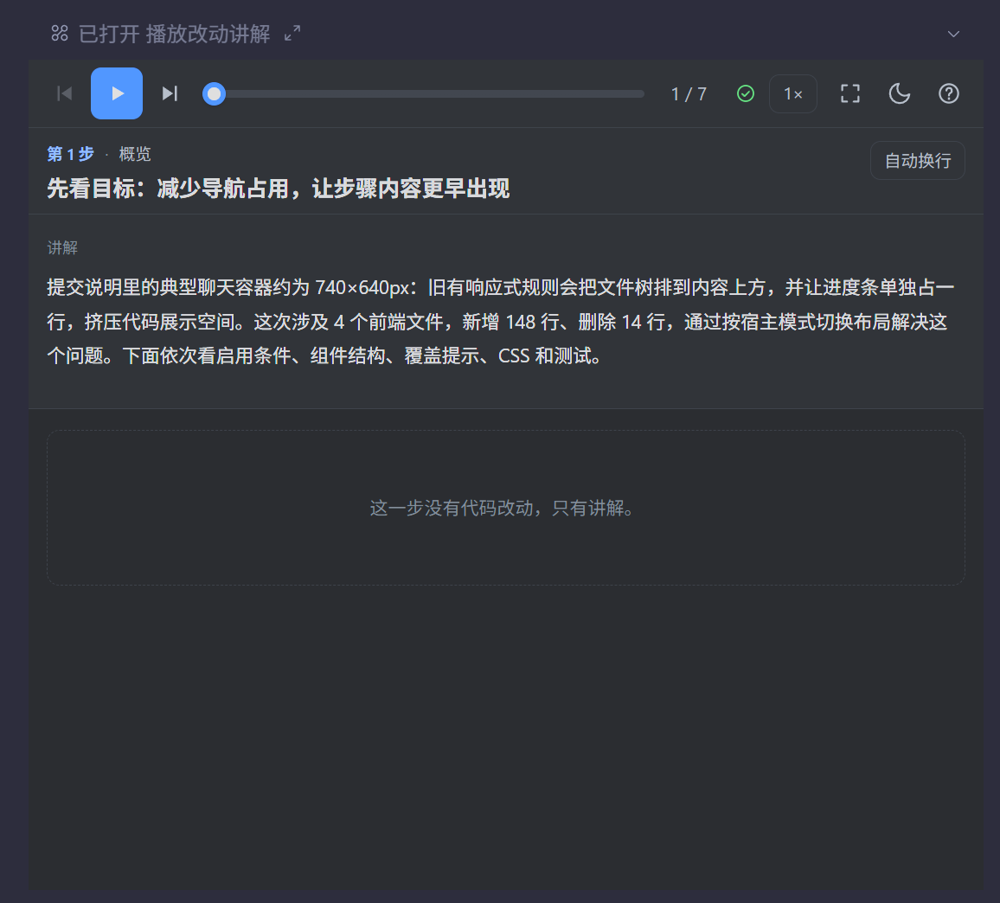
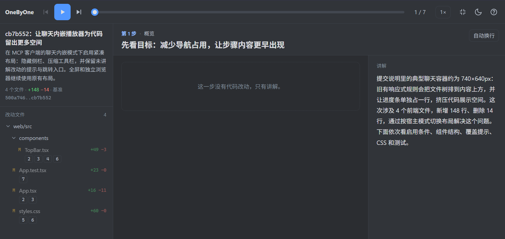

<div align="center">
    
    <h1>OneByOne</h1>
</div>

一步一步看懂 AI 的代码改动：把一次改动拆成有顺序的步骤，每一步显示对应的 diff 和讲解。  
修改agents配置之后，改完代码时对 AI 说"讲解一下这次的改动"，它会先调用 `get_changes`，再按写法要求调用 `show_walkthrough`；没讲全时结果里会列出遗漏的改动块，AI 补全后再提交一次。

## Show

<table>
<tr>
<td width="300" align="center"><br><sub>narrow</sub></td>
<td width="500" align="center"><br><sub>wide</sub></td>
</tr>
</table>

## 下载安装

在 [Releases](https://github.com/ZoveRKI/OneByOne/releases) 页面下载对应系统的压缩包：

| 系统 | 文件 |
|---|---|
| Windows（x64） | `onebyone-<版本>-windows-x64.zip` |
| macOS（Apple 芯片） | `onebyone-<版本>-macos-arm64.dmg` |
| macOS（Intel 芯片） | `onebyone-<版本>-macos-x64.dmg` |

- 解压后得到程序 `onebyone`（Windows 上是 `onebyone.exe`）
    - 可以放在任意位置
    - 建议放在固定位置
        - Win: `C:\Users\<用户名>\.cargo\bin\onebyone.exe`
        - Mac: `/Users/<用户名>/.cargo/bin/onebyone`
- 使用时还需要装好 Git，程序通过它读取改动。
- 程序没有代码签名，第一次使用前可能要解除系统的拦截：
    - 被拦截后到"系统设置 → 隐私与安全性"里点"仍要打开"
    - 也可以运行 `xattr -d com.apple.quarantine <程序路径>`

## 从源码安装

需要准备：

| 工具 | 版本 | 用途 |
|---|---|---|
| Node.js | 22.12 以上 | 构建和测试播放器 |
| pnpm | 10 以上 | 管理前端依赖 |
| Rust（cargo） | 1.88 以上 | 编译命令行 |
| Git | 任意较新版本 | 命令行通过它读取改动 |

仓库根目录的 `mise.toml` 记录了 CI 使用的 Node.js 和 pnpm 版本，装了 [mise](https://mise.jdx.dev/) 的话，在仓库里会自动用这些版本。

命令行会把播放器页面嵌进程序，所以**先构建前端，再编译安装命令行**。在仓库根目录运行：

```bash
pnpm -C web install
pnpm -C web build
cargo install --path server --locked
```

- 程序会装到 `~/.cargo/bin`
    - Win: `C:\Users\<用户名>\.cargo\bin\onebyone.exe`
    - Mac: `/Users/<用户名>/.cargo/bin/onebyone`
- 整个程序只有这一个文件，播放器页面已经嵌在里面。

## 支持的工具
| Logo | 工具 |
|:---:|------|
|  | Claude Code |
|  | Codex |

## 修改agents配置

⚠️修改前请先备份配置文件，并彻底退出对应agents应用
- 改完后重新打开应用、新开一个会话就能用了
- Codex支持对话中嵌入播放器（紧凑布局）。Claude不支持（手动打开`.onebyone/walkthrough.html`）
- 由于对话宽度限制，使用侧边标签页查看讲解体验更好

### Codex

| 系统 | 配置文件 |
|---|---|
| Windows | `C:\Users\<用户名>\.codex\config.toml` |
| macOS | `~/.codex/config.toml` |

- 在文件末尾加上下面这段。如果已经有 `[mcp_servers.onebyone]`，改那一段，不要重复写。
    ```toml
    [mcp_servers.onebyone]
    command = '<程序路径>'
    args = ["mcp"]
    ```
- 装了 Codex 命令行时，也可以运行 `codex mcp add onebyone -- <程序路径> mcp`，效果相同。

### Claude

| 系统 | 配置文件 |
|---|---|
| Windows | `C:\Users\<用户名>\.claude.json` |
| macOS | `~/.claude.json` |

- 在文件最外层加上 mcpServers。已经有 mcpServers 时，只在它里面加 onebyone 这一项
    ```
    {
        ..其他配置..,
        ..其他配置..,
        "mcpServers": {
            "onebyone": {
                "type": "stdio",
                "command": "<程序路径>",
                "args": ["mcp"],
                "env": {}
            }
        }
    }
    ```
- 装了 Claude Code 命令行时，也可以运行 `claude mcp add --scope user onebyone -- <程序路径> mcp`，它会替你写好这一段。

## 更新和卸载

### 更新

- 下载安装：下载新版本的压缩包，用里面的程序替换旧文件
- 从源码安装：拉取新代码后，按安装时的顺序重新构建并安装
- Windows 不允许替换正在运行的程序，所以替换之前要先彻底退出 Codex 和 Claude
    - 或者在任务管理器里结束所有 `onebyone.exe` 进程
        ```powershell
        Get-Process onebyone -ErrorAction SilentlyContinue | Stop-Process
        ```
        ```nushell
        ps | where name =~ 'onebyone' | each {|p| kill --force $p.pid }
        ```
- macOS 上可以直接替换
- 无论哪个系统，已经开着的会话都会继续用旧版，新开的会话才会用上新版。

### 卸载

- 下载安装：删除程序文件
- 从源码安装：运行 `cargo uninstall onebyone`
- 再从 Codex 和 Claude 的配置文件里删掉 onebyone 那一段
- 各个项目里生成的 `.onebyone/` 目录可以直接删除

## 许可证

本项目采用以下任一许可证，由你选择：

- [Apache License 2.0](LICENSE-APACHE)
- [MIT License](LICENSE-MIT)

除非你另有明确声明，你有意提交到本项目的任何贡献（按 Apache-2.0 许可证中的定义），都按上述两种许可证授权，不附加任何其他条款或条件。
